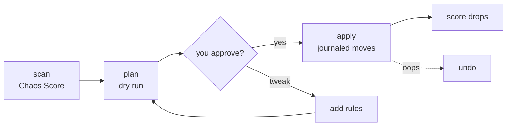

<p align="center"></p>

<p align="center">
  <a href="https://github.com/NISTALTALSON/adhd-or-ocd/actions/workflows/ci.yml"></a>
  <a href="LICENSE"></a>
  
  
  
  <a href="https://github.com/NISTALTALSON/adhd-or-ocd/stargazers"></a>
</p>

> **Your Desktop has 214 files called `final_FINAL_v2 (3).pdf`. Fix it in 60 seconds. Undo it with one command.**

A skill for [Claude](https://claude.ai), Claude Code, Codex and any agent that follows the Agent Skills folder format (a `SKILL.md` plus scripts). Say *"ADHD or OCD, clean my Downloads"* and it scans, scores your chaos, shows a dry-run plan, moves files only after you say yes, and journals every move so you can reverse it.

It is also a plain Python script with **zero dependencies**, so you can run it without any AI at all.

## Two brains, one skill

| | **ADHD mode** (default) | **OCD mode** |
|---|---|---|
| Vibe | "I just want the pile gone." | "Do it properly. Make it a system." |
| Layout | `_Sorted/<type>` and `_Review/`, one level | PARA + Johnny.Decimal: `10_Projects`, `20_Areas`, `30_Resources`, `40_Media`, `90_Archive`... |
| Renames files? | Never (nothing to second-guess) | Yes: `2026-11-08_invoice-airtel.pdf` |
| Time to clean | ~60 seconds | a few minutes, once |
| Good for | Desktop, Downloads | Documents, college folders, a decade of backups |

*The names are a playful nod to two organizing styles, not a diagnosis. Whatever your brain does, your folders deserve better.*

## See it work

A deliberately gross 12-file folder (real output, nothing staged):

```text
$ python scripts/organize.py scan Messy

Chaos Score: 45/100 [####------]  (0 = zen, 100 = gremlin cave)
Verdict: OCD-style chaos: a maze of folders and fiddly file names

$ python scripts/organize.py plan Messy --mode ocd --depth 2

  20_Areas/Career                  1 files   e.g. resume-final-final-v2.docx
  20_Areas/Finance                 1 files   e.g. invoice-airtel.pdf
  20_Areas/Education/Semester 3    1 files   e.g. unit-1-notes.pdf
  40_Media/Screenshots/2026-11     1 files   e.g. 2026-11-06_003308_screenshot.png
  50_Software/Installers           1 files   e.g. setup.exe
  99_Review/Duplicates             1 files   e.g. photo copy.JPG
  99_Review/Junk-Candidates        2 files   e.g. empty.txt, ~$temp.docx
Skipped 1: shortcuts/.ini files (left where they are)
Left alone (looks like projects): 1 folders
Nothing was moved.

$ python scripts/organize.py apply <plan>
Moved 10 files, skipped 0, removed 1 empty folders.
Chaos Score: 45 -> 1/100

$ python scripts/organize.py undo Messy
Restored 10 files.
```

`Copy of resume final FINAL v2.docx` became `20_Areas/Career/resume-final-final-v2.docx`. The git project next to it was never touched.

## Install (30 seconds)

**Claude Code / Codex / other agents**
```bash
git clone https://github.com/NISTALTALSON/adhd-or-ocd ~/.claude/skills/adhd-or-ocd
```
Windows PowerShell: clone, then run `./install.ps1` (copies into `.claude\skills` and `.codex\skills` if present). macOS/Linux: `./install.sh`.

**Claude.ai**: download this repo as a ZIP and upload it as a skill in Settings. Then just ask.

**No AI, just the script**
```bash
python scripts/organize.py scan ~/Downloads
python scripts/organize.py plan ~/Downloads --mode adhd
python scripts/organize.py apply <the plan path it prints>
```

## Why you can trust it with your files

- **Dry run first.** `plan` writes a file and moves nothing. You read it, then `apply`.
- **Never deletes. Never overwrites.** Duplicates and junk go to a `Review` folder. Name clashes get `-2`, `-3`.
- **One-command undo.** Every move and every folder created is journaled; `undo` reverses it, even the empty folders.
- **Protected by default:** git repos and any folder with `package.json`, `pyproject.toml`, etc., shortcuts, hidden/system files, files edited in the last 30 minutes, symlinks.
- **Refuses dangerous targets:** drive roots, your bare home folder, `C:\Windows`, `/usr`, AppData.
- **Exact duplicates only** (size, then SHA-256). "Looks similar" is never "duplicate".
- **Local only.** No network, no telemetry, no uploads. When used through an AI, sensitive files (IDs, bank, medical) are routed by file name; the skill is told never to open them.
- **Tested:** CI runs a plan → apply → undo round trip on Linux, Windows and macOS and fails if a single byte changes.

## The Chaos Score

Every scan and every apply prints a 0-100 score (lower is calmer) and a verdict: *piles* (ADHD-style) or *maze* (OCD-style). It weighs loose files, exact duplicates, copy-marker names, empty and one-file folders, stale files and temp junk. Formula in [references/methodology.md](references/methodology.md). Post your before/after with **#adhdorocd** and flex.

## Make it yours

Rules are plain regexes against the normalized file name; first match wins.

```json
[{"match": "\\b(invoice|receipt|payslip)\\b", "to": "20_Areas/Finance"},
 {"match": "my startup|pitch deck",            "to": "10_Projects/My-Startup"}]
```
```bash
python scripts/organize.py plan ~/Documents --mode ocd --rules my-rules.json --depth 3
```
See [examples/rules.example.json](examples/rules.example.json). With the AI skill, Claude reads your files' names, proposes rules like these, and re-plans before anything moves.

Handy flags: `--depth 3` dig into subfolders (their folder names are kept as context) · `--dest <folder>` organize *into* somewhere else · `--prune-empty` · `--archive-days 180` · `--keep-names` · `--flatten`.

## How it works



The script handles everything deterministic. The AI handles judgment: which files form a project, what your rules should be, and explaining the plan in plain English. Design notes and sources (PARA, Johnny.Decimal, ISO 8601, NIST file-naming guidance) are in [references/methodology.md](references/methodology.md).

## Roadmap

- [ ] `watch` mode: auto-sweep `_Inbox` on a schedule (always dry-run + notify)
- [ ] EXIF dates for photos
- [ ] Near-duplicate images (opt-in, review-only)
- [ ] Localized screenshot and document-name patterns
- [ ] Shareable Chaos Score card image

## Contributing

PRs welcome, especially regional document-name rules and extra Chaos Score signals. Ground rule: never lose a user's file. See [CONTRIBUTING.md](CONTRIBUTING.md).

---

<p align="center">If this saved your Desktop, <b>⭐ star the repo</b> so other people with <code>New folder (7)</code> find it.<br>Built by <a href="https://github.com/NISTALTALSON">@NISTALTALSON</a> · MIT licensed</p>
