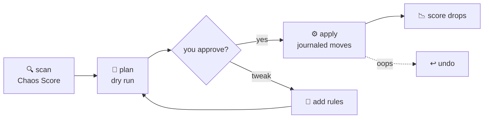

<p align="center"></p>

<p align="center">
  <a href="https://github.com/NISTALTALSON/adhd/actions/workflows/ci.yml"></a>
  <a href="LICENSE"></a>
  
  
  <a href="https://github.com/NISTALTALSON/adhd/stargazers"></a>
</p>

<p align="center">
  <b>Claude Skill</b> · <b>Claude Code</b> · <b>Codex</b> · <b>plain CLI</b> &nbsp;|&nbsp; Windows · macOS · Linux
</p>

<h3 align="center">Your Desktop has 214 files called <code>final_FINAL_v2 (3).pdf</code>.<br>Fix it in 60 seconds. Undo it with one command.</h3>

<p align="center">
  <a href="#-30-second-demo">Demo</a> ·
  <a href="#-install-in-30-seconds">Install</a> ·
  <a href="#-two-modes">Modes</a> ·
  <a href="#-why-you-can-trust-it-with-your-files">Safety</a> ·
  <a href="#-faq">FAQ</a>
</p>

---

**ADHD** is a skill for [Claude](https://claude.ai) (and any agent that follows the `SKILL.md` folder format) that cleans up a messy file system **without ever deleting anything**. It scans, gives you a **Chaos Score**, shows a dry-run plan, moves files only after you say yes, and journals every move so you can reverse it.

Built for brains that hate filing systems: one rule, zero guilt, always undoable. It is also a plain Python script with **zero dependencies**, so you can run it without any AI.

## 🎬 30-second demo

<p align="center"></p>

That is a real run on a deliberately gross 12-file folder. `Copy of resume final FINAL v2.docx` became `20_Areas/Career/resume-final-final-v2.docx`. The git project sitting next to it was never touched.

## 📉 The Chaos Score

<p align="center"></p>

Every scan and every apply prints a 0-100 score (lower is calmer) and a verdict: **piles** (loose files everywhere) or a **maze** (nested folders, fiddly names). It weighs loose files, exact duplicates, copy-marker names, empty and one-file folders, stale files and temp junk. Formula in [`references/methodology.md`](references/methodology.md). Post your before/after with **#chaosscore**.

## ⚡ Install in 30 seconds

<details open>
<summary><b>Claude Code / Codex / any skills-compatible agent</b></summary>

```bash
git clone https://github.com/NISTALTALSON/adhd ~/.claude/skills/adhd
```
Then say: **"ADHD, clean my Downloads."** On Windows you can also run `./install.ps1` after cloning (copies into `.claude\skills` and `.codex\skills`); on macOS/Linux, `./install.sh`.
</details>

<details>
<summary><b>Claude.ai</b></summary>

Download this repo as a ZIP and upload it as a skill in Settings. Then just ask.
</details>

<details>
<summary><b>No AI, just the script</b></summary>

```bash
python scripts/organize.py scan ~/Downloads
python scripts/organize.py plan ~/Downloads --mode quick
python scripts/organize.py apply <the plan path it prints>
python scripts/organize.py undo ~/Downloads        # changed your mind?
```
</details>

## 🧠 Two modes

| | ⚡ **Quick** (default) | 💎 **Perfect** |
|---|---|---|
| Vibe | "I just want the pile gone." | "Do it properly. Make it a system." |
| Layout | `_Sorted/<type>` and `_Review/`, one level | PARA + Johnny.Decimal: `10_Projects`, `20_Areas`, `30_Resources`, `40_Media`, `90_Archive` |
| Renames files? | Never (nothing to second-guess) | Yes: `2026-11-08_invoice-airtel.pdf` |
| Time | ~60 seconds | a few minutes, once |
| Best for | Desktop, Downloads | Documents, college folders, a decade of backups |

## ✨ What you get

| | | |
|---|---|---|
| 🔍 **Scan first**<br>Read-only report and Chaos Score before anything moves | 🧪 **Dry-run plans**<br>See exactly where each file goes, then approve | ↩️ **One-command undo**<br>Every move and created folder is journaled |
| 👯 **Exact-duplicate finder**<br>Size, then SHA-256. Copies go to review, not the bin | 🧹 **Junk quarantine**<br>Temp files, `~$` locks and 0-byte files parked safely | 🏷️ **Clean names**<br>ISO dates, no `(1)`, no "copy", kebab-case (Perfect mode) |
| 🗂️ **Project-aware**<br>Git repos and `package.json` folders are never entered | 📸 **Screenshot sorting**<br>`2026-11-06_130011_screenshot.png`, filed by month | 🧠 **AI judgment pass**<br>Claude reads file *names*, proposes your rules, re-plans |
| 🌏 **Regional rules**<br>Aadhaar, PAN, marksheets, GST out of the box | 📥 **Inbox sweep**<br>`--dest` organizes Downloads into another folder | 🧰 **Zero dependencies**<br>One Python file, 3.8+, works offline |

## 🛡️ Why you can trust it with your files

- **Dry run first.** `plan` writes a file and moves nothing. You read it, then `apply`.
- **Never deletes. Never overwrites.** Duplicates and junk go to a `Review` folder. Name clashes get `-2`, `-3`.
- **Undo is real.** Every move and every created folder is journaled; `undo` reverses it, empty folders included.
- **Protected by default:** git repos and any folder with `package.json`, `pyproject.toml` and friends, shortcuts, hidden and system files, files edited in the last 30 minutes, symlinks.
- **Refuses dangerous targets:** drive roots, your bare home folder, `C:\Windows`, `/usr`, AppData.
- **Exact duplicates only.** "Looks similar" is never "duplicate".
- **Local only.** No network, no telemetry, no uploads. Through an AI, sensitive files (IDs, bank, medical) are routed by file name; the skill is told never to open them.
- **Tested on 3 operating systems.** CI runs a plan → apply → undo round trip on Linux, Windows and macOS and fails if a single byte changes.

## 🆚 How it compares

| | Manual cleanup | Typical "sort by extension" script | **ADHD** |
|---|---|---|---|
| Preview before moving | n/a | rarely | ✅ always |
| Undo | ❌ | rarely | ✅ journaled |
| Never deletes | depends on you at 2 a.m. | varies | ✅ by design |
| Leaves code projects alone | you remember (or not) | ❌ often breaks them | ✅ |
| Exact-duplicate detection | ❌ | rarely | ✅ SHA-256 |
| Understands *your* files (rules from names) | ✅ but slow | ❌ | ✅ with an AI agent |
| Tells you if it worked | vibes | ❌ | ✅ Chaos Score |

## 🎛️ Make it yours

Rules are plain regexes run against the normalized file name; first match wins.

```json
[{"match": "\\b(invoice|receipt|payslip)\\b", "to": "20_Areas/Finance"},
 {"match": "my startup|pitch deck",            "to": "10_Projects/My-Startup"}]
```
```bash
python scripts/organize.py plan ~/Documents --mode perfect --rules my-rules.json --depth 3
```
More in [`examples/rules.example.json`](examples/rules.example.json). Handy flags: `--depth 3` dig into subfolders (their names are kept as context) · `--dest <folder>` organize *into* somewhere else · `--prune-empty` · `--archive-days 180` · `--keep-names` · `--flatten`.

## 🧩 How it works



The script handles everything deterministic. The AI handles judgment: which files form a project, what your rules should be, and explaining the plan in plain English. Design notes and sources (PARA, Johnny.Decimal, ISO 8601, NIST file-naming guidance) are in [`references/methodology.md`](references/methodology.md).

## ❓ FAQ

<details><summary><b>Will it delete my files?</b></summary>
No. It has no delete code path. Duplicates and junk are moved to a <code>Review</code> folder for you to empty.
</details>

<details><summary><b>Will it break my coding projects?</b></summary>
No. Any folder containing a git repo, <code>package.json</code>, <code>pyproject.toml</code>, <code>Cargo.toml</code>, <code>.sln</code> and similar markers is treated as one unit and left exactly where it is.
</details>

<details><summary><b>What if I change my mind?</b></summary>
<code>python scripts/organize.py undo &lt;folder&gt;</code> reverses the latest run. Files you edited since are left alone and reported.
</details>

<details><summary><b>Does it need an AI?</b></summary>
No. The script runs standalone. The AI skill adds the judgment layer: plain-English explanations and rules tailored to your files.
</details>

<details><summary><b>Does it read my documents?</b></summary>
No. Everything is decided from names, extensions, sizes and dates. Duplicate detection hashes bytes locally and never reads text.
</details>

<details><summary><b>OneDrive, iCloud or Dropbox folders?</b></summary>
Works, but online-only files may start downloading when moved. Run it on a local folder first.
</details>

<details><summary><b>Why is it called ADHD?</b></summary>
Because the people who need this most are the ones who will never maintain a perfect system. It is designed around that: one shot, low friction, forgiving, undoable. It is a file tool, not a medical product, and it makes no claims about treating anything.
</details>

## 🗺️ Roadmap

- [ ] `watch` mode: auto-sweep `_Inbox` on a schedule (always dry-run + notify)
- [ ] EXIF dates for photos
- [ ] Near-duplicate images (opt-in, review only)
- [ ] Localized screenshot and document-name patterns
- [ ] Shareable Chaos Score card image

## ⭐ Star history

<a href="https://star-history.com/#NISTALTALSON/adhd&Date"></a>

## 🤝 Contributing

PRs welcome, especially regional document-name rules and extra Chaos Score signals. Ground rule: **never lose a user's file.** See [CONTRIBUTING.md](CONTRIBUTING.md).

---

<p align="center">If this saved your Desktop, <b>⭐ star the repo</b> so other people with <code>New folder (7)</code> can find it.<br><br>Built by <a href="https://github.com/NISTALTALSON">@NISTALTALSON</a> · MIT licensed</p>
